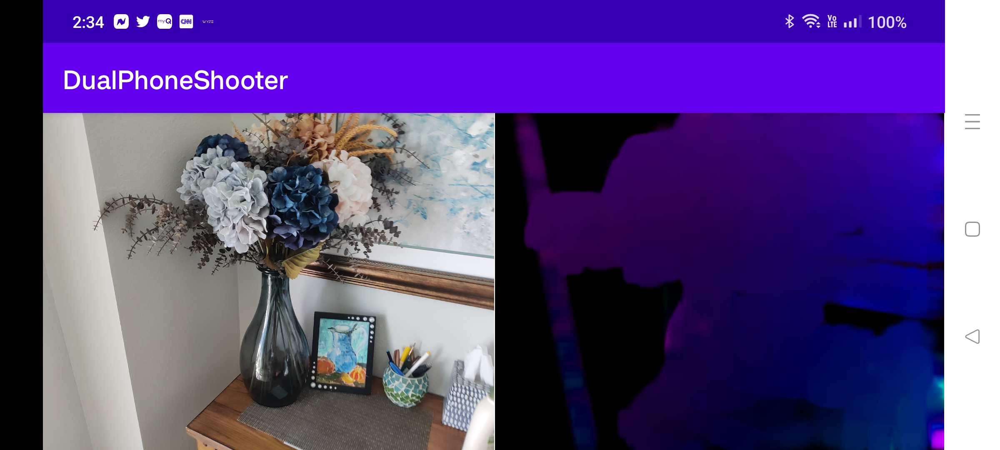

# DPShooter

DPShooter is an Android application engineered to leverage the capabilities of the camera to compute optical flow. Constructed using OpenCV and Android's CameraX library, this application offers a streamlined method for calculating and displaying optical flow. Furthermore, it visualizes an interpolated frame through optical flow-based forward warping.

 

## Features
- Uses the CameraX API to capture frames from camera.
- Ultra-fast edge-preserving optical flow calculation is achieved through computing optical flow at random locations using the Lucas-Kanade method with OpenCV. The sparse estimation is subsequently interpolated to produce a dense optical flow field through multi-scale guided filtering.
- RGB display of optical flow.
- An intermediate frame is displayed through forward warping, based on the dense optical flow fields. The warping is implemented in OpenGL. 

## Getting Started

### Prerequisites
- Android Studio 3.0 or later.
- Android SDK (API level 21 or higher).
- A physical Android device or emulator.

### Installation
1. Clone the repository from GitHub.
2. Open the project in Android Studio.
3. Run the app on your Android device or emulator.

## Usage
Launch the application on your device. The application will begin capturing frames from your camera and compute the optical flow.

## Contributing
Pull requests are welcome. For major changes, please open an issue first to discuss what you would like to change.

## License
This project is licensed under the MIT License. See the [LICENSE](LICENSE) file for details.

## Acknowledgments
- OpenCV for powerful image processing tools.
- Android's CameraX library for a simpler camera experience.
